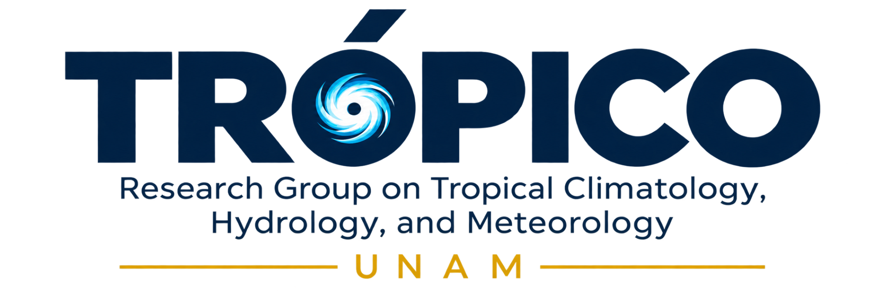

  

# Global Atmospheric Monitor

**Explore the latest available daily global atmospheric anomalies.**

[**Explore the Interactive Monitor**](https://tropicoresearch.github.io/global-atmospheric-monitor/)

Global Atmospheric Monitor is an interactive scientific visualization developed by **Alejandro Jaramillo-Moreno**, Research Scientist at the Instituto de Ciencias de la Atmósfera y Cambio Climático (ICAyCC), Universidad Nacional Autónoma de México (UNAM), and founder of **TRÓPICO — Research Group on Tropical Climatology, Hydrology, and Meteorology**.

The platform displays global atmospheric anomalies for the most recent day with complete data available from **NOAA CPC CORe**, using a **1991–2020 reference climatology**.

The interactive 3D globe includes 11 atmospheric variables, stationary wind streamlines at 850 and 250 hPa, adjustable visualization controls, and automated daily updates.

Detailed information about the datasets, climatological methodology, and scientific interpretation is available directly on the [monitor website](https://tropicoresearch.github.io/global-atmospheric-monitor/).

---

### Creator and Maintainer

**[Alejandro Jaramillo-Moreno](https://ajaramillomoreno.github.io/)**  
Research Scientist · ICAyCC, UNAM  
Founder of TRÓPICO

### Disclaimer

Global Atmospheric Monitor is an independent scientific visualization and outreach initiative. It is not an official operational product of NOAA or UNAM.
